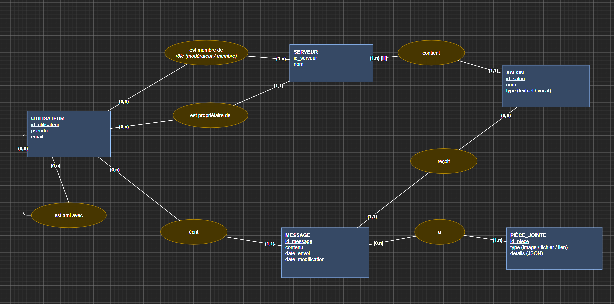

### Phase 0 :


Discord a dû résoudre une augmentation importante du nombre d'utilisateurs et de communautés sans avoir prévu des bases solides qui auraient pu supporter la charge. Le produit a été construit en moins de deux mois début 2015, et en 2017 l'équipe ne comptait que quatre ingénieurs back-end, sans équipe d'exploitation dédiée. Les lectures sont extrêmement aléatoires et c'est donc compliqué de prévoir ce qui va être demandé par le client et ce qui peut être mis en cache. En plus de cela, on voit émerger des serveurs très différents dans leur utilisation des données. MongoDB va vite montrer ses limites quand environ 100 millions de messages vont devoir être stockés : les données et l'index ne tiennent plus en mémoire vive. Pour remédier à ça, ils vont transférer la base de données sur Cassandra en 2017 avec une nouvelle architecture : un cluster de 12 nœuds avec un facteur de réplication de 3. Problème : les partitions déclenchent des avertissements au-delà de 100 Mo, donc les messages sont regroupés par fenêtres de temps d'environ 10 jours. L'autre problème avec Cassandra est que Discord y crée des tombstones en grande quantité (valeurs NULL écrites, messages supprimés), ce qui laisse beaucoup de débris dans la base de données et augmente le temps de lecture. Ne plus écrire les valeurs nulles et réduire la durée de vie des tombstones de 10 jours à 2 va régler ce problème. Les gros salons consomment beaucoup plus que les petits, ce qui ralentit tous les salons qui sont sur les mêmes nœuds. Pour résoudre ces problèmes et améliorer la vitesse, la base de données va migrer vers ScyllaDB. La nouvelle architecture aura 72 nœuds.

Évolution de 12 nœuds en 2017 à 177 en 2022 sur Cassandra. Pour moi, ce chiffre montre l'évolution très rapide du volume de messages par rapport à la capacité de l'infrastructure : il a fallu multiplier les nœuds par presque 15 pour suivre.

Seuil de 100 Mo par partition. Il oblige à découper les messages d'un salon en petites partitions (fenêtres d'environ 10 jours), ce qui optimise la charge de l'infrastructure.

50 messages par écran. C'est la lecture type demandée par le client : elle est petite, mais c'est la requête la plus fréquente, donc c'est pour elle que l'infrastructure doit être rapide.


### Phase 1 : ce que le système doit garantir

1.a :

| Acteur                    | Ce qu'il crée                                                                         | Ce qu'il supprime                                                                    |
| ------------------------- | ------------------------------------------------------------------------------------- | ------------------------------------------------------------------------------------ |
| Utilisateur               | Son compte, ses appartenances en rejoignant des serveurs, ses messages, ses amitiés   | [H] Ses propres messages, ses amitiés, ses appartenances à un serveur, son compte    |
| Modérateur                | [H] Des salons                                                                        | [H] Les messages des autres, des appartenances                                       |
| Propriétaire d'un serveur | [H] Le serveur, ses salons, les rôles de modérateur                                   | [H] Le serveur, ses salons                                                           |
| Système                   | Les présences, à chaque signe de vie, et le tableau de bord une fois par jour         | Les présences, qui expirent après 5 minutes                                          |


| Objet              | Créé par                                                                           | Fin de vie                                                                            |
| ------------------ | ---------------------------------------------------------------------------------- | ------------------------------------------------------------------------------------- |
| Serveur            | [H] Un utilisateur, qui en devient le propriétaire                                 | [H] Supprimé par le propriétaire, ce qui supprime aussi ses salons et ses appartenances |
| Salon              | [H] Le propriétaire ou un modérateur, dans un serveur                              | [H] Supprimé par les mêmes, ou avec le serveur                                        |
| Appartenance       | L'utilisateur qui rejoint le serveur, celle du propriétaire naît avec le serveur   | [H] Départ volontaire ou exclusion                                                    |
| Statut de présence | Le système, à chaque signe de vie                                                  | Il expire tout seul après 5 minutes                                                   |
| Compte utilisateur | L'utilisateur, à l'inscription                                                     | [H] Supprimé par l'utilisateur                                                        |
| Message            | Un membre du serveur, dans un salon textuel                                        | [H] Supprimé par l'auteur ou un modérateur                                            |
| Pièce jointe       | L'auteur, en même temps que le message                                             | [H] Supprimée avec le message                                                         |
| Amitié             | Deux utilisateurs                                                                  | [H] Supprimée par l'un des deux                                                       |
| Tableau de bord    | Le système, une fois par jour                                                      | [H] Jamais supprimé                                                                   |


[H] = hypothèse : le cahier des charges (§9) ne le précise pas.


Glossaire :

| Glossaire |
| --------- |
| serveur : le serveur est un point qui regroupe des salons créés par les utilisateurs. Pour avoir accès à ces salons, les utilisateurs doivent rejoindre ce serveur |
| membre : c'est un utilisateur qui a rejoint un serveur |
| nœuds : les machines du cluster de la base de données, chaque donnée est copiée sur 3 nœuds différents (12 nœuds chez Discord en 2017 [A1]) |
| partition : petit bout de la base de données, léger et auquel on peut accéder facilement |
| salons : discussion regroupant les messages de différents utilisateurs, rangés dans l'ordre de leur envoi, du plus récent au plus ancien |
| ami : liaison entre 2 utilisateurs qui leur permet d'échanger en messages privés et de se retrouver facilement sur un serveur |
| présence : le statut de présence est propre à chaque utilisateur et permet d'indiquer si l'utilisateur s'est connecté récemment et s'il est sur Discord ou sur son PC en ce moment |
| tombstone : débris laissés par Cassandra, ce sont des marqueurs de suppression restés dans la base de données, ce qui encombre la base et la ralentit |
| fenêtre : tranche de temps (environ 10 jours chez Discord [A1]) dans laquelle on regroupe les messages d'un salon, pour que chaque partition reste sous 100 Mo |
| message : texte envoyé par un utilisateur, il pèse 300 octets en moyenne (H1 [H]), identifiants, horodatages et métadonnées inclus |


1.b :


| Garantie par le modèle | Garantie seulement par du code ou un trigger | Hors modèle relationnel |
| ---------------------- | -------------------------------------------- | ----------------------- |
| L'utilisateur a un pseudo. (NOT NULL) | Le propriétaire d'un serveur est aussi membre de ce serveur. (il faut comparer la table serveur et la table membre) | La forme d'une pièce jointe varie selon son type. (forme variable) |
| Un utilisateur peut rejoindre zéro ou plusieurs serveurs. (table membre avec 2 FK) | Pour écrire dans un salon, l'auteur doit être membre du serveur de ce salon. (il faut lire 3 tables : salon, serveur, membre) | On affiche en permanence qui est en ligne. (ça change sans arrêt et c'est lu tout le temps) |
| Un utilisateur peut être propriétaire de zéro ou plusieurs serveurs. (rien à vérifier) | Seuls les salons textuels reçoivent des messages. (il faut aller lire le type du salon dans la table salon) | Une présence expire d'elle-même après 5 min sans signe de vie. (expiration) |
| Un serveur a un seul propriétaire. (une seule colonne id_proprietaire dans serveur, NOT NULL + FK) | [H] Un serveur contient au moins un salon. (l'application crée un salon par défaut à la création du serveur, et un trigger interdit de supprimer le dernier) | On suggère à un utilisateur des serveurs où ses amis sont déjà. (liens de proche en proche) |
| Un membre a un seul rôle dans un serveur : modérateur ou membre. (une seule colonne role + CHECK) | [H] Un serveur a au moins un membre. (le propriétaire est ajouté à la création du serveur, et un trigger bloque le départ du dernier membre) | On suggère à un utilisateur des personnes que ses amis connaissent. (liens de proche en proche) |
| Un salon appartient à un seul serveur. (FK id_serveur NOT NULL) | Le contenu du champ details correspond au type de la pièce jointe. (vérifié par le code de l'application) | Chaque serveur a un tableau de bord. (résultat calculé) |
| Un message appartient à un seul salon. (FK id_salon NOT NULL) | | Le tableau de bord est mis à jour une fois par jour. (calcul une fois par nuit) |
| Un message a un seul auteur, et un utilisateur écrit zéro ou plusieurs messages. (FK id_auteur NOT NULL) | | L'écran principal affiche les 50 derniers messages d'un salon, c'est la requête la plus fréquente. (gros volume, toujours lu de la même façon) |
| L'e-mail d'un utilisateur correspond à un seul compte. (UNIQUE sur email) | | |
| L'utilisateur n'est membre qu'une seule fois d'un même serveur. (clé primaire sur le couple utilisateur + serveur) | | |
| Le nom d'un salon est unique dans un serveur. (UNIQUE sur le couple serveur + nom) | | |
| Un salon est textuel ou vocal. (CHECK) | | |
| Un message a un contenu et une date d'envoi. (NOT NULL) | | |
| Un message peut avoir une date de modification. (colonne qui peut rester vide) | | |
| [H] Une date de modification est après la date d'envoi. (CHECK, les deux dates sont sur la même ligne) | | |
| Un message a zéro ou une pièce jointe. (FK id_message UNIQUE dans piece_jointe) | | |
| Un utilisateur peut avoir zéro ou plusieurs amis. (table amitie avec 2 FK) | | |
| Une amitié n'existe qu'une seule fois par paire. (CHECK id_user1 < id_user2 + clé primaire sur la paire) | | |
| [H] Un utilisateur ne peut pas être ami avec lui-même. (CHECK id_user1 < id_user2) | | |


1.c :


Décision 1 : rôle d'un membre

Je mets le rôle dans l'association "est membre de", parce qu'un rôle n'existe que dans un serveur précis, Tom peut très bien être modérateur sur un serveur et simple membre sur un autre. J'aurais pu faire une entité RÔLE, mais créer une table entière juste pour deux valeurs (modérateur et membre) alourdirait la base pour rien. Un CHECK sur la colonne role suffit, et la règle reste garantie par le modèle. Si un jour le client veut des rôles personnalisés avec des permissions, là il faudra passer par une entité RÔLE (voir la question 4 du 1.e).

Décision 2 : amitié

L'amitié relie un utilisateur à un autre utilisateur, c'est donc une association réflexive, avec (0,n) des deux côtés. Le piège serait de stocker les deux sens (Léa-Tom et Tom-Léa) : chaque amitié prendrait deux fois plus de place, et si Léa supprime Tom il pourrait rester le doublon Tom-Léa dans la base. Pour éviter ça j'ai mis un CHECK (id_user1 < id_user2), qui oblige à mettre le plus petit identifiant en premier, et une clé primaire sur la paire pour bloquer les doublons. Le même CHECK empêche aussi d'être ami avec soi-même, donc ça règle deux problèmes d'un coup.

Décision 3 : propriétaire

Pour le propriétaire j'ai hésité entre deux solutions. La première, c'est d'ajouter un rôle "propriétaire" dans "est membre de", mais la base ne pourrait pas garantir toute seule qu'un serveur a toujours un propriétaire. J'ai donc pris la deuxième : une association à part, "est propriétaire de", entre SERVEUR (1,1) et UTILISATEUR (0,n). Avec une colonne id_proprietaire obligatoire dans serveur, c'est la base elle-même qui garantit qu'il n'y a qu'un propriétaire. Je n'ai pas voulu garder les deux en même temps, parce qu'avec deux endroits où noter le propriétaire, un bug pourrait faire que deux personnes se retrouvent propriétaires du même serveur, et on ne saurait plus qui a le droit de le supprimer. Le seul défaut de mon choix, c'est qu'il faut quand même un trigger pour vérifier que le propriétaire est bien membre de son serveur. Par contre le cahier des charges (exigence 2) parle d'un rôle "propriétaire", et moi je ne le stocke pas dans la colonne role, on le retrouve avec serveur.id_proprietaire, et dans MEMBRE la ligne du propriétaire a le rôle "moderateur" [H].

Décision 4 : pièces jointes

Une image, un fichier et un lien n'ont pas du tout les mêmes informations. Si je mettais tout dans une seule table avec une colonne par information, une ligne "lien" aurait toutes les autres cases vides, et à chaque nouveau type (sondage, vidéo...) il faudrait rajouter des colonnes. Mettre la pièce jointe en attribut du message ne marche pas non plus, une seule case ne suffit pas. J'ai donc fait une entité PIÈCE_JOINTE sans forme fixe, avec une colonne type (image, fichier ou lien) contrôlée par un CHECK, et un champ libre en JSON pour les détails, où on peut mettre n'importe quelle forme. L'inconvénient, c'est que la base ne contrôle plus ce qu'il y a dans ce champ, ce qui peut créer des bugs ou des failles de sécurité. Il faudra donc le vérifier avec du code dans l'application.

Décision 5 : messages

Je garde MESSAGE comme une entité normale du MCD, avec ses liens vers SALON et UTILISATEUR, parce que le MCD décrit ce qu'on stocke, pas encore où ni comment on le stocke. Mais pour moi ce n'est pas une entité comme les autres : les messages sont de loin les plus nombreux, ils sont lus énormément, et presque toujours de la même façon (les 50 derniers d'un salon, H5). Chez Discord c'est vers 100 millions de messages que les temps de réponse de MongoDB sont devenus imprévisibles [A1], je pense donc que leur stockage doit être décidé à part, en phase 3.


1.d :

MLD :

Clé primaire soulignée, clé étrangère précédée de #.

| Table | Colonne 1 | Colonne 2 | Colonne 3 | Colonne 4 | Colonne 5 | Colonne 6 |
| --- | --- | --- | --- | --- | --- | --- |
| utilisateur | <u>id_utilisateur</u> | pseudo | email |  |  |  |
| serveur | <u>id_serveur</u> | nom | #id_proprietaire |  |  |  |
| membre | <u>#id_utilisateur</u> | <u>#id_serveur</u> | role |  |  |  |
| salon | <u>id_salon</u> | nom | type | #id_serveur |  |  |
| message | <u>id_message</u> | contenu | date_envoi | date_modification | #id_salon | #id_auteur |
| piece_jointe | <u>id_piece</u> | type | details | #id_message |  |  |
| amitie | <u>#id_user1</u> | <u>#id_user2</u> |  |  |  |  |

MEMBRE et AMITIE ont une clé primaire composée : c'est le couple des deux colonnes qui est unique, et chaque colonne est aussi une clé étrangère. #id_auteur, #id_proprietaire, #id_user1 et #id_user2 pointent tous vers UTILISATEUR.

Règles de passage :

- contient : SERVEUR (1,n) / SALON (1,1) -> règle 1-n : clé étrangère côté 1 -> #id_serveur dans SALON.
- reçoit : SALON (0,n) / MESSAGE (1,1) -> règle 1-n : clé étrangère côté 1 -> #id_salon dans MESSAGE.
- écrit : UTILISATEUR (0,n) / MESSAGE (1,1) -> règle 1-n : clé étrangère côté 1 -> #id_auteur dans MESSAGE.
- est propriétaire de : UTILISATEUR (0,n) / SERVEUR (1,1) -> règle 1-n : clé étrangère côté 1 -> #id_proprietaire dans SERVEUR.
- est membre de : UTILISATEUR (0,n) / SERVEUR (1,n) -> règle n-n : table de liaison MEMBRE (#id_utilisateur, #id_serveur, role).
- est ami avec : UTILISATEUR (0,n) / UTILISATEUR (0,n) -> règle n-n : table de liaison AMITIE (#id_user1, #id_user2).
- a : MESSAGE (0,1) / PIÈCE_JOINTE (1,1) -> règle 1-1 : clé étrangère + UNIQUE -> #id_message UNIQUE dans PIECE_JOINTE.

Les minimums à 1 côté SERVEUR (au moins un membre, au moins un salon [H]) ne laissent aucune trace dans les tables : ils doivent être garantis par l'application.

Types :

| Table | Colonne | Type | Justification |
| --- | --- | --- | --- |
| toutes | identifiants (id_...) | BIGINT | Snowflake, entier de 64 bits [A1] |
| UTILISATEUR | pseudo | VARCHAR(12) | [H] 12 caractères |
| UTILISATEUR | email | VARCHAR(254) | Longueur max d'une adresse selon la RFC 5321 |
| SERVEUR, SALON | nom | VARCHAR(100) | [H] |
| SALON | type | VARCHAR(8) | "textuel" ou "vocal" |
| MEMBRE | role | VARCHAR(10) | "moderateur" ou "membre" |
| MESSAGE | contenu | TEXT | Longueur libre |
| MESSAGE | date_envoi, date_modification | TIMESTAMPTZ | Date et heure avec fuseau, ça permet de regrouper par jour pour le tableau de bord |
| PIECE_JOINTE | type | VARCHAR(7) | "image", "fichier" ou "lien" |
| PIECE_JOINTE | details | JSONB | Champ libre (décision 4 du 1.c) |

MPD (PostgreSQL) :

```sql
CREATE TABLE utilisateur (
  id_utilisateur BIGINT       PRIMARY KEY,
  pseudo         VARCHAR(12)  NOT NULL,          -- un utilisateur a un pseudo
  email          VARCHAR(254) NOT NULL UNIQUE    -- un e-mail = un seul compte
);

CREATE TABLE serveur (
  id_serveur      BIGINT       PRIMARY KEY,
  nom             VARCHAR(100) NOT NULL,
  id_proprietaire BIGINT       NOT NULL REFERENCES utilisateur  -- un seul propriétaire
);

CREATE TABLE membre (
  id_utilisateur BIGINT      NOT NULL REFERENCES utilisateur ON DELETE CASCADE,
  id_serveur     BIGINT      NOT NULL REFERENCES serveur ON DELETE CASCADE,
  role           VARCHAR(10) NOT NULL DEFAULT 'membre'
                 CHECK (role IN ('moderateur', 'membre')),     -- un seul rôle parmi deux
  PRIMARY KEY (id_utilisateur, id_serveur)                     -- membre une seule fois
);

CREATE TABLE salon (
  id_salon   BIGINT       PRIMARY KEY,
  id_serveur BIGINT       NOT NULL REFERENCES serveur ON DELETE CASCADE,  -- un salon a un seul serveur
  nom        VARCHAR(100) NOT NULL,
  type       VARCHAR(8)   NOT NULL CHECK (type IN ('textuel', 'vocal')),
  UNIQUE (id_serveur, nom)                                     -- nom unique dans le serveur
);

CREATE TABLE message (
  id_message        BIGINT      PRIMARY KEY,
  id_salon          BIGINT      NOT NULL REFERENCES salon ON DELETE CASCADE,  -- un seul salon
  id_auteur         BIGINT      NOT NULL REFERENCES utilisateur, -- un seul auteur
  contenu           TEXT        NOT NULL,
  date_envoi        TIMESTAMPTZ NOT NULL,
  date_modification TIMESTAMPTZ,                                 -- peut rester vide
  CHECK (date_modification > date_envoi)                         -- modification après envoi
);

CREATE TABLE piece_jointe (
  id_piece   BIGINT     PRIMARY KEY,
  id_message BIGINT     NOT NULL UNIQUE REFERENCES message ON DELETE CASCADE,  -- zéro ou une pièce jointe
  type       VARCHAR(7) NOT NULL CHECK (type IN ('image', 'fichier', 'lien')),
  details    JSONB      NOT NULL                               -- forme variable
);

CREATE TABLE amitie (
  id_user1 BIGINT NOT NULL REFERENCES utilisateur ON DELETE CASCADE,
  id_user2 BIGINT NOT NULL REFERENCES utilisateur ON DELETE CASCADE,
  PRIMARY KEY (id_user1, id_user2),   -- une seule fois par paire
  CHECK (id_user1 < id_user2)         -- pas de doublon inversé, pas ami avec soi-même
);
```

Si date_modification est vide (NULL), le CHECK laisse passer, et c'est voulu : un message qui n'a jamais été modifié n'a pas de date de modification.

Pour les suppressions j'ai mis des ON DELETE CASCADE, supprimer un serveur supprime ses salons, ses appartenances et ses messages, et une pièce jointe part avec son message. Par contre je n'en ai pas mis sur id_proprietaire ni sur id_auteur, tant que le client n'a pas répondu aux questions 1 et 3 du 1.e la base refuse de supprimer un compte qui possède un serveur ou qui a écrit des messages.

Il reste des règles que je ne peux pas écrire en SQL, ce sont celles de la colonne 2 du 1.b. Elles seront garanties par un trigger ou par l'application : le propriétaire doit être membre de son serveur, seuls les salons textuels reçoivent des messages, l'auteur d'un message doit être membre du serveur du salon, un serveur a au moins un membre (et au moins un salon selon mon hypothèse [H]), et le contenu du champ details doit correspondre au type de la pièce jointe.

Index :

```sql
CREATE INDEX idx_message_salon ON message (id_salon, id_message DESC);
CREATE INDEX idx_membre_serveur ON membre (id_serveur);
CREATE INDEX idx_amitie_user2 ON amitie (id_user2);
```

| Index | Requête servie | Pourquoi |
| --- | --- | --- |
| message (id_salon, id_message DESC) | Les 50 derniers messages d'un salon (exigence 10, la plus fréquente) | On trouve d'abord le salon, puis on lit du plus récent au plus ancien, la base lit 50 entrées et elle s'arrête. J'ai trié sur id_message et pas sur date_envoi, parce que deux messages peuvent avoir exactement la même date alors qu'un Snowflake est unique et déjà dans l'ordre chronologique [A1] |
| membre (id_serveur) | Les membres d'un serveur, et les serveurs où sont mes amis (exigence 8) | La clé primaire (id_utilisateur, id_serveur) commence par l'utilisateur, donc elle ne sert à rien pour chercher par serveur |
| amitie (id_user2) | Les amis d'un utilisateur (exigence 8) | Une amitié n'est stockée qu'une fois, donc pour trouver les amis de Léa il faut regarder les lignes où elle est en id_user1 et celles où elle est en id_user2. La clé primaire sert pour id_user1, et cet index pour id_user2 |

Je n'ai pas mis d'index sur les salons d'un serveur, parce que le UNIQUE (id_serveur, nom) en crée déjà un qui commence par id_serveur. Je n'en ai pas mis non plus sur les messages d'un auteur : aucune exigence ne le demande souvent, et l'index ralentirait chaque envoi de message, alors que les écritures représentent environ 50 % des accès [A1].


1.e :

Question 1 : que devient un serveur quand son propriétaire supprime son compte ?

Si on décide de supprimer le serveur, il faudra ajouter un ON DELETE CASCADE sur id_proprietaire, et comme les salons, les appartenances et les messages sont déjà en cascade sur le serveur, tout part avec le compte.

Si on préfère transférer le serveur, on ne met pas de cascade, et un trigger nomme un nouveau propriétaire (par exemple le plus ancien modérateur) avant que le compte soit supprimé.

Et si on laisse 15 jours à l'utilisateur pour récupérer son compte, il faudra ajouter une colonne date_suppression (TIMESTAMPTZ) dans UTILISATEUR, et un traitement qui supprime vraiment les comptes au bout des 15 jours.

Question 2 : un serveur peut-il exister sans salon ? Pour moi non, un serveur sans salon n'a pas vraiment de sens.

Si la réponse est non, je garde SERVEUR (1,n) / SALON. Le modèle ne peut pas le garantir tout seul, donc l'application crée un salon par défaut quand on crée le serveur, et un trigger empêche de supprimer le dernier salon.

Si c'est oui, on passe à SERVEUR (0,n) / SALON, et là il n'y a plus rien à vérifier, le modèle est plus simple.

Question 3 : que deviennent les messages d'un utilisateur qui supprime son compte ?

Moi je choisirais de les garder, avec l'auteur affiché en "utilisateur supprimé". Il y a deux façons de faire : soit id_auteur devient facultatif avec un ON DELETE SET NULL, soit les messages pointent vers un utilisateur spécial. Dans le premier cas il faudra enlever le NOT NULL sur id_auteur dans le MPD, dans le deuxième le MPD ne change pas. Comme il n'y a pas de suppression massive, ça ne charge pas l'infrastructure pour rien.

Si on choisit de les supprimer, c'est un ON DELETE CASCADE sur id_auteur. Le problème, c'est que ça peut faire des milliers de suppressions d'un coup, et c'est exactement ce qui a créé chez Discord des millions de tombstones et des lectures de 20 secondes [A1].

Question 4 : les propriétaires peuvent-ils créer leurs propres rôles, avec un nom et des permissions ?

Pour le moment je pars sur non, donc je garde la colonne role dans MEMBRE avec son CHECK (modérateur ou membre).

Si c'est oui, il faut une nouvelle entité RÔLE liée à un serveur : ROLE (<u>id_role</u>, nom, permissions, #id_serveur), et dans MEMBRE la colonne role devient une clé étrangère vers ROLE. Et si un membre peut avoir plusieurs rôles en même temps, il faudra en plus une table de liaison MEMBRE_ROLE.

Question 5 : un message peut-il avoir plusieurs pièces jointes ?

Pour le moment non, donc ça reste MESSAGE (0,1) / PIÈCE_JOINTE (1,1), avec id_message UNIQUE dans PIECE_JOINTE.

Si c'est oui, ça devient MESSAGE (0,n) / PIÈCE_JOINTE (1,1). Il suffit d'enlever le UNIQUE, et chaque pièce jointe est une ligne qui pointe vers son message. Ce que je ne veux surtout pas faire, c'est mettre plusieurs pièces jointes dans une seule case, ça casserait la première forme normale.


### Phase 2 : qui interroge quoi

2.a :

| Accès | Lecture / écriture | Fréquence | Latence visée | Forme | Cohérence |
| --- | --- | --- | --- | --- | --- |
| Afficher les 50 derniers messages d'un salon | Lecture | La plus fréquente de la plateforme (§9) | < 80 ms au 95e centile [H] (je reprends le seuil d'alerte de Discord [A1]) | Plage | Tolère quelques secondes de retard [H] |
| Envoyer un message | Écriture | Environ autant que les lectures (ratio 50/50 [A1]) | < 80 ms au 95e centile [H] (je reprends le seuil d'alerte de Discord [A1]) | Clé | Stricte |
| Vérifier qu'un utilisateur peut écrire | Lecture | Une fois avant chaque envoi, donc autant que les envois | Quelques ms [H] (ça s'ajoute à l'envoi) | Clé | Stricte |
| Afficher qui est en ligne | Lecture + écriture | Écriture : un signe de vie par utilisateur connecté, environ toutes les minutes [H]. Lecture : en permanence | < 1 s [H] | Clé | Éphémère |
| Suggérer des serveurs (exigence 8) | Lecture | Calcul toutes les heures ou une fois par jour [H] | Calcul lent accepté, affichage < 1 s [H] | Parcours de relations | Tolère du retard |
| Calculer l'activité d'un serveur (exigence 9) | Lecture | Une fois par jour (§9) | Calcul de nuit, durée libre, affichage < 1 s [H] | Agrégat | Tolère du retard (jusqu'à 24 h) |
| Supprimer un message | Écriture | Rare par rapport aux envois [H] | < 1 s [H], moins prioritaire que l'envoi et la lecture | Clé | Stricte |
| Rechercher dans l'historique | Lecture | Occasionnelle, bien plus rare que l'affichage [H] | 1 à 2 s [H] | Recherche | Tolère du retard |


2.b :

1. Débit d'écriture en décembre 2016

Il y a 86 400 secondes dans une journée (24 x 60 x 60), donc en moyenne 100 000 000 messages par jour [A1] / 86 400 s = 1 157 environ, soit à peu près 1 160 messages par seconde.

Avec un pic 3 fois plus haut que la moyenne (H2), on arrive à 1 157 x 3 = 3 472 environ, donc à peu près 3 500 messages par seconde.

2. Volume stocké

Avec 300 octets par message (H1) : 100 000 000 x 300 = 30 000 000 000 octets, donc 30 Go par jour.

Sur un an, ça fait 30 x 365 = 10 950 Go, environ 11 To.

Ce calcul part du principe que le rythme de décembre reste le même toute l'année [H], ce qui n'est pas vraiment le cas : Discord grandissait très vite (40 millions de messages par jour en juillet, 100 millions en décembre [A1]). Je pense donc que c'est une estimation plutôt basse.

3. Taille à 100 millions de messages (MongoDB, 2015)

Pour les données : 100 000 000 x 300 octets (H1) = 30 000 000 000 octets, donc 30 Go.

Pour l'index : 100 000 000 entrées x 40 octets (H3) = 4 000 000 000 octets, donc 4 Go.

Avec 16 Go de mémoire vive (H4), l'index tient en mémoire (4 Go < 16 Go), mais pas les données (30 Go > 16 Go).

Une fois l'index chargé, il reste 16 - 4 = 12 Go pour les données, ce qui fait 12 / 30 = 40 % des messages. Comme les lectures sont extrêmement aléatoires [A1], si je pars du principe qu'elles sont réparties sur tous les messages [H], environ 60 % d'entre elles doivent aller chercher sur le disque, qui est beaucoup plus lent que la mémoire. Le temps de réponse dépend donc un peu du hasard : rapide si le message est déjà en mémoire, lent sinon. Pour moi c'est ce qui explique les temps de réponse "imprévisibles" dont parle le dossier à 100 millions de messages [A1].

Si je fais varier H1, avec 150 octets par message les données font 15 Go et avec 600 octets 60 Go, dans les deux cas ça dépasse les 12 Go disponibles, donc la conclusion ne change pas.

4. Contrôle de vraisemblance (Cassandra, 2017)

Sur les disques, il y a 12 nœuds x 1 To [A1] = 12 To.

Mais avec un facteur de réplication de 3 [A1], chaque donnée est stockée 3 fois, donc il n'y a en réalité que 12 / 3 = 4 To de données différentes.

Ça donne 4 000 000 000 000 octets / 300 octets (H1) = 13 300 000 000 environ, soit à peu près 13 milliards de messages.

C'est cohérent avec les "milliards de messages" du dossier [A1]. Et comme le 1 To par nœud est un volume compressé, le vrai nombre est sûrement un peu plus haut.


2.c :

Dénormalisation 1 : tableau de bord

Compter tous les messages d'un serveur à chaque fois qu'on affiche le tableau de bord serait beaucoup trop coûteux, c'est une contrainte de reporting. Je fais donc une table agrégée ACTIVITE_SERVEUR_JOUR (#id_serveur, jour, nb_messages, nb_auteurs), recalculée chaque nuit. Ça veut dire que les chiffres peuvent avoir jusqu'à un jour de retard, ce que le §9 accepte, et que ça rajoute un calcul chaque nuit. Pour que ça reste fiable, j'affiche sur le tableau de bord la date du dernier calcul, je garde une ligne par jour pour avoir l'historique, et je mets une alerte si le dernier calcul a plus de 24 h.

Dénormalisation 2 : les 50 derniers messages d'un salon

Ici la contrainte c'est le trafic, puisque c'est la requête la plus fréquente de toute la plateforme (§9). Je mets donc en cache, en mémoire, les messages récents de chaque salon. Il sert surtout aux grands serveurs publics, où on lit la dernière heure (§3). Par contre il n'aide pas les serveurs à dominante vocale ni les petits serveurs privés, où on lit des messages trop anciens ou trop peu demandés pour rester en cache (§3), pour eux il faudra compter sur l'index. Le problème, c'est qu'il y a deux copies à garder synchronisées, et on risque d'afficher un message qui a déjà été modifié ou supprimé. Pour éviter ça, à chaque modification ou suppression le code met à jour ou efface le cache (invalidation), et je donne au cache une durée de vie courte [H] pour qu'une erreur finisse par disparaître toute seule.

Dénormalisation 3 : suggestions de serveurs

Pour suggérer des serveurs il faut partir de moi, aller voir mes amis, puis leurs serveurs, et refaire ce parcours à chaque affichage serait beaucoup trop lent avec autant de trafic. Je fais donc un modèle de lecture séparé, une table SUGGESTION_SERVEUR (#id_utilisateur, #id_serveur, nb_amis, date_calcul), recalculée toutes les heures ou une fois par jour [H]. Les suggestions peuvent donc être un peu en retard, mais pour une suggestion ce n'est pas grave d'attendre le calcul suivant. Comme garde-fou je reste sur quelque chose de léger pour ne pas charger l'infrastructure : au moment de l'affichage, on retire juste les serveurs que l'utilisateur a déjà rejoints (une simple recherche par clé dans MEMBRE).

Refus : copier le pseudo dans MESSAGE

Là je refuse de dénormaliser. Si un utilisateur change de pseudo, il faudrait parcourir toute la table des messages pour réécrire l'ancien, et vu le nombre de messages ça consommerait énormément de ressources. En plus le gain serait faible, retrouver un pseudo c'est une recherche par clé primaire dans UTILISATEUR, c'est déjà très rapide. Pour le droit de modifier un message, on continue à vérifier avec id_auteur, qui lui ne change jamais.
